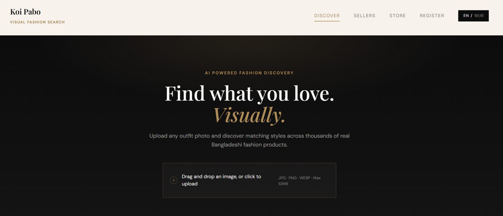
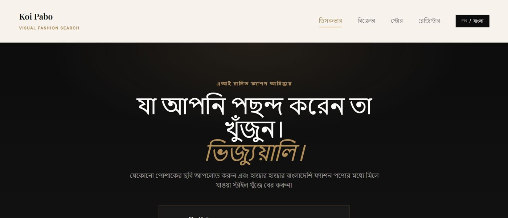
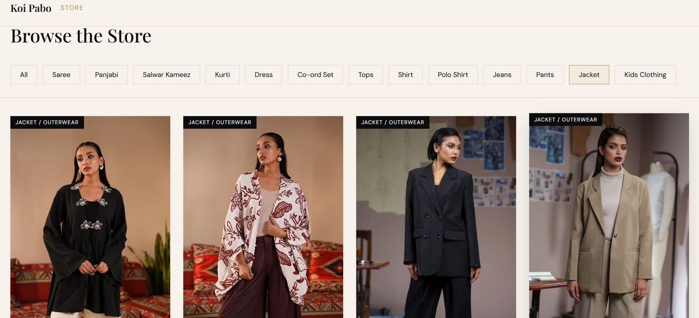
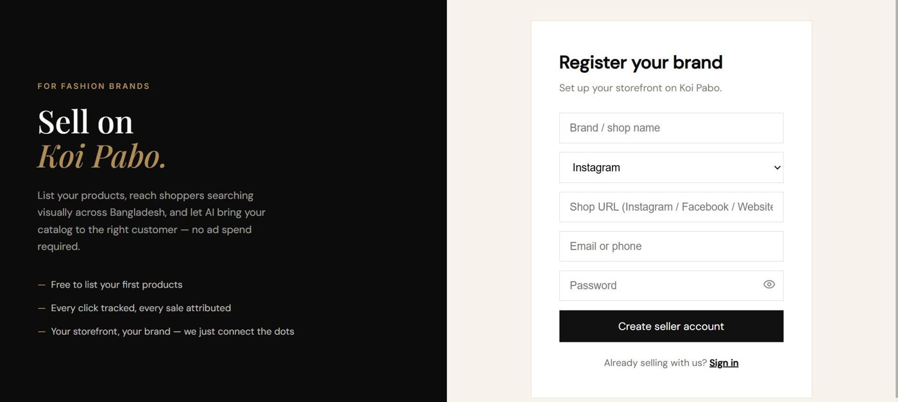

# Koi Pabo 👀 (কই পাবো?)

**Visual search for Bangladeshi fashion.** Upload a photo of an outfit you saw on Instagram, Facebook, or the street, and Koi Pabo finds visually similar products from Bangladeshi brands and sellers, with price and a link to buy.

> NSU CSE 499 capstone project, built by Noshin Nawar and Anika Sayeed.
> Supervisor: Dr. Shazzad Hosain, North South University.

> **This is a showcase repository.** The source code lives in a private repository. See [Code access](#code-access) below if you'd like to review it.

| | |
|---|---|
| **Live demo** | https://koi-pabo-4kej.vercel.app |
| **API** | https://koipabo-b416.onrender.com |

[](https://youtube.com/shorts/axGEHsQomKk)

> The backend may take a while to wake up on the first request if it's on a free hosting tier.

<p align="center">
  
  
</p>
<p align="center">
  
  
</p>

---

## Why this exists

Most Bangladeshi fashion shopping starts on Instagram and Facebook, but there's no way to search across those sellers by *how something looks*. Keyword search fails when you only have a photo and don't know what the item is called. Koi Pabo takes the photo as the query.

## How it works

```
Photo upload ──► FashionCLIP encoder (512-d, L2-normalised)
                          │
                          ▼
                FAISS nearest-neighbour search
                          │
                          ▼
        Product IDs ──► PostgreSQL metadata ──► ranked results in React UI
```

- **Embeddings:** [FashionCLIP](https://huggingface.co/patrickjohncyh/fashion-clip), a CLIP model fine-tuned on fashion data (third-party model, not trained by us).
- **Search:** FAISS vector index, with results mapped back to product records.
- **Click tracking:** every "View" button goes through a redirect endpoint that logs the click and supports affiliate codes.
- **Sellers:** can register, log in, and upload products, which are embedded and added to the live index.

## Features

- Search by image, with a similarity score per result
- Browse the store by category
- Bangla / English interface
- Seller registration, login, dashboard, and product upload
- User auth: Google sign-in, email/password, phone/password, OTP verification
- Click logging for analytics and affiliate attribution

## Tech stack

| Layer | Tools |
|---|---|
| Frontend | React, Vite, React Router, Google OAuth |
| Backend | FastAPI, SQLAlchemy, Pydantic, JWT, bcrypt |
| ML | PyTorch, Hugging Face Transformers, FashionCLIP, FAISS |
| Data | PostgreSQL (Supabase), Cloudinary |
| Hosting | Vercel (frontend), Render (backend) |

## Roadmap

- [ ] Fine-tune a Bangladesh-specific model (BdCLIP) on local garment categories and benchmark it against the base model
- [ ] Sponsored listings in search ranking
- [ ] Switch to an IVF index as the catalogue grows
- [ ] Seller onboarding for Instagram/Facebook-based brands
- [ ] Mobile app

## Known limitations

- The base model is trained mostly on Western fashion data, so retrieval on some South Asian garments is weaker. This is the main motivation for the BdCLIP work.
- Similarity scores are model estimates, not guarantees of an exact match.
- CPU-only inference; fine for prototype scale, not for large production traffic.

## Code access

The source code is kept in a private repository because Koi Pabo is an ongoing project with a private product catalogue. If you're a recruiter, supervisor, or potential collaborator and would like to review the code, send a short request via [LinkedIn](https://www.linkedin.com/in/noshin-nawar5) with your name, organisation, and what you'd like to look at. We'll grant read access to the private repository on a case-by-case basis.

## Team

- **Noshin Nawar**: [GitHub](https://github.com/noshin-nawar5) · [LinkedIn](https://www.linkedin.com/in/noshin-nawar5) · [Hugging Face](https://huggingface.co/noshin-nawar)
- **Anika Sayeed**: [GitHub](https://github.com/anikaIX)

## License

Copyright (c) 2026 Noshin Nawar and Anika Sayeed. **All rights reserved.** The content of this repository may be viewed for evaluation but not copied, redistributed, or reused without written permission. See [LICENSE](LICENSE).
